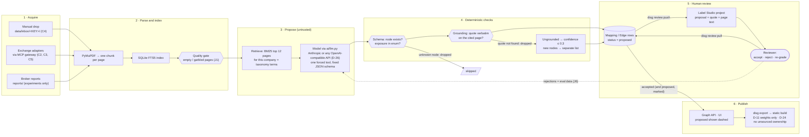
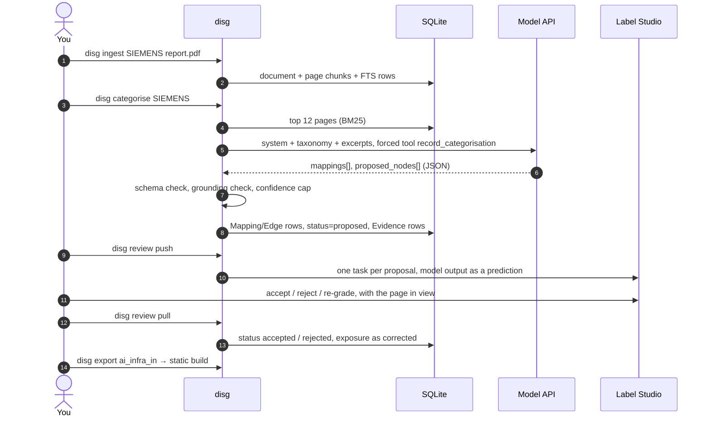

# Human-in-the-loop ingestion pipeline

*Design of the evidence pipeline: documents in, model proposes, deterministic checks, human decides,
graph out. Owned by this document; roadmap IDs and decisions live in the project register.*

## 1. The idea in one line

**The model is an untrusted proposer; the checks are code; the human is the authority.** Nothing a model
writes reaches the graph as a fact until a person has looked at it with its evidence beside it (D-08, D-09).

## 2. Pipeline

The same picture as a sequence, for one company:

## 3. Stages

| # | Stage | What runs | Trust | Built |
|---|---|---|---|---|
| 1 | Acquire | Manual inbox, exchange adapters behind the MCP gateway | Documents are **untrusted input** | Manual `disg ingest` yes; inbox and adapters C2–C5 not yet |
| 2 | Parse and index | PyMuPDF, one chunk per page (< 40 chars skipped), FTS5 | Deterministic | Yes (C1). J1: 1,253 PDFs, 0 unreadable, < 1% empty pages |
| 3 | Propose | BM25 retrieval, then one model call with a forced tool and a fixed schema | Model output is **untrusted** | Yes; provider-neutral since D-26 |
| 4 | Check | Node must exist; quote must be verbatim on the cited page (first 120 normalised chars); ungrounded → confidence ≤ 0.3; new nodes kept apart | Deterministic | Yes (`apply_categorisation`) |
| 5 | Review | Proposals pushed to Label Studio, decisions pulled back | **Human is the authority** | Proposed: `disg review push/pull` (Q16) |
| 6 | Publish | Graph API and UI; `disg export` → static single-file build | Only what review allowed, with D-11 and D-24 filters | Yes (H2) |

## 4. What the checks prove, and what they don't

| Check | Proves | Does not prove |
|---|---|---|
| Fixed tool schema | The output has the right shape; nodes come from the taxonomy | That the mapping is right |
| Grounding | The quoted words are on the cited page (**provenance**) | That the page is true, or that the quote supports the mapping (**truth**) |
| Confidence cap | An unquoted claim cannot look confident | Anything about a quoted one |
| Human review | A person with the evidence in front of them agreed | Nothing beyond that person's judgement — which is why it is the last step, not a formality |

J3 shows why the last row matters: text an attacker places on a page is quoted back verbatim, passes
grounding, and arrives in the queue looking exactly like real evidence.

## 5. Model layer (D-26)

`backend/supplygraph/ai/llm.py` is the only code that talks to a model. Two calls (`call_tool`,
`call_text`), two adapters:

| `DISG_PROVIDER` | Endpoint | Key | Examples |
|---|---|---|---|
| `anthropic` (default) | Anthropic Messages API | `ANTHROPIC_API_KEY` or `DISG_API_KEY` | `claude-sonnet-4-5`, `claude-sonnet-5`, `claude-haiku-4-5` |
| `openai` | Any OpenAI-compatible Chat Completions endpoint, set by `DISG_BASE_URL` | `OPENAI_API_KEY` or `DISG_API_KEY` | OpenAI; OpenRouter (`https://openrouter.ai/api/v1`); Gemini, Groq, Together, Mistral; local Ollama (`http://localhost:11434/v1`), LM Studio, llama.cpp, vLLM |

`DISG_MODEL` names the model on whichever provider is chosen. Everything after the call (stage 4 onward)
is the same for every provider, so switching provider changes who proposes, never what gets accepted.

**Local models (Ollama, LM Studio, llama.cpp).** Two guards in `llm.py` apply only when `DISG_BASE_URL`
points at the local machine:

- *Truncation check.* Ollama keeps only the last `num_ctx` tokens of a long prompt and says nothing, so
  the model would answer from the back half of the evidence. If the server counts under half the
  estimated prompt tokens, the call raises `ContextTruncated`. Fix it on the server:
  `OLLAMA_CONTEXT_LENGTH=32768 ollama serve` (`make ollama-serve`).
- *JSON fallback.* A local server may ignore the forced tool call and answer in prose, or reject
  `tool_choice`. The same JSON Schema is then requested as structured output (`response_format:
  json_schema`), with `<think>` blocks and code fences stripped. `Usage.fallback` records it.
  The answer still goes through schema, grounding and review like any other.

`disg llm-check` (`make qwen-check`) tests a model for exactly this: it places a code at the *start* of a
~16k-token prompt and asks for it back through the tool. The check fails if the window is too small,
if there's no structured output, or if the server can't be reached. It also reports prompt tokens per
second. Make targets: `ollama-serve`, `qwen-pull`, `qwen-check`, `qwen-env`.

Not yet recorded: *which* model proposed a mapping. `Source.ai` doesn't distinguish Claude from Qwen,
so comparing them on the same company needs a `model` column on `Mapping` (a migration).

## 6. Review with Label Studio (proposed, Q16)

A standard annotation tool instead of building the C6 screen.

- **Run:** one container (`heartexlabs/label-studio`), SQLite, on localhost only — tasks contain document
  text.
- **Task = one proposal:** company, node, exposure, confidence, rationale, the quote, and the full page
  text with the quote highlighted. The model's output goes in as a *prediction*, so the reviewer starts from
  it and changes only what is wrong.
- **Labels:** `accept` / `reject`, plus exposure re-grade (`core` / `meaningful` / `peripheral`) and a
  free-text note.
- **Sync:** `disg review push` creates tasks for every `proposed` row not yet pushed (task id stored on the
  row); `disg review pull` reads finished annotations and sets `status` and `exposure`. A webhook can replace
  the pull later.
- **Same tool for J6:** the experiments' review sheet becomes a second Label Studio project, so "grounded"
  can be set against "correct" without a separate UI.

## 7. State

| Row | Written by | Status values | Notes |
|---|---|---|---|
| `Document`, `Chunk` | ingest | — | Dedup key `document.url` (C3) |
| `Mapping` | seed, categorise | `proposed` → `accepted` / `rejected` | `source` = seed / manual / ai; AI rows always start `proposed` |
| `Evidence` | categorise | — | Only grounded quotes are stored |
| `Edge`, `Node` | categorise (`proposed_nodes`), expand | `proposed` → … | New nodes reach the taxonomy only through review |

## 8. Failure modes

| Failure | Where caught | Effect |
|---|---|---|
| PDF has no text layer (scan) | Stage 2 quality gate | Pages skipped; nothing to propose. OCR is not in scope yet |
| Model answers in prose, no tool call | `llm.NoToolCall` | Company skipped, logged; retry or switch model |
| Model invents a node | Stage 4 schema check | Mapping dropped (`skipped`) |
| Model paraphrases the quote | Stage 4 grounding | Quote dropped, confidence ≤ 0.3, still reviewed |
| Hostile text in a document | Not caught automatically (J3) | Reaches review looking like evidence; the reviewer is the control |
| Provider outage or rate limit | SDK retries, then error | Re-run; nothing half-written (one transaction per company) |

## 9. Open

- **Q16:** review tool — Label Studio (recommended), Argilla (needs Elasticsearch), or build C6.
- Whether the public static build shows `proposed` rows at all, or accepted only (H3).
